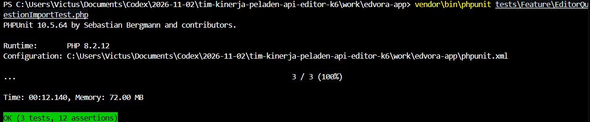

# Laporan Hasil PHPUnit: Import Excel Soal Editor

**Tanggal pencatatan:** 2 November 2026  
**File test:** `tests/Feature/EditorQuestionImportTest.php`  
**Branch:** `test/naila-phpunit`

## Ringkasan

Test fitur memeriksa unggahan Excel soal Editor, batas jumlah soal, validasi kunci jawaban, dan status awal soal baru. Test menggunakan trait `DatabaseTransactions`; tidak menjalankan migration dan transaksi test di-rollback setelah selesai.

## Hasil yang sudah terkonfirmasi

| Skenario | Hasil terakhir yang diketahui | Bukti |
|---|---|---|
| Unggah 500 soal valid; semua soal berstatus `draft` | Lulus | PHPUnit sebelumnya: `OK (2 tests, 9 assertions)` |
| Kunci jawaban tidak valid (`Z`); unggahan ditolak dan tidak ada soal tersimpan | Lulus | PHPUnit sebelumnya: `OK (2 tests, 9 assertions)` |
| Unggah 501 soal; unggahan ditolak dan tidak ada soal tersimpan | Belum terverifikasi | Skenario sudah ditambahkan ke test setelah hasil 2-test di atas |


## Percobaan menjalankan ulang

Perintah:

```powershell
vendor\bin\phpunit tests\Feature\EditorQuestionImportTest.php
```

Pada percobaan ulang tanggal 2 November 2026, PHPUnit berhenti sebelum menjalankan test dengan pesan:

```text
Cannot open bootstrap script "...\vendor\autoload.php"
```

Ini adalah kendala bootstrap saat menjalankan dari sesi tersebut, bukan hasil gagal dari assertion test. Jalankan kembali perintah di atas dari terminal VS Code dalam folder proyek untuk mendapatkan hasil terbaru bagi ketiga skenario.

## Kesimpulan

Dua skenario awal telah lulus sebelumnya. Skenario batas 501 soal sudah ada di source test, tetapi hasilnya perlu dikonfirmasi lewat eksekusi PHPUnit yang berhasil.
